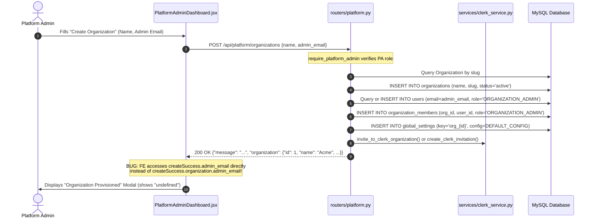
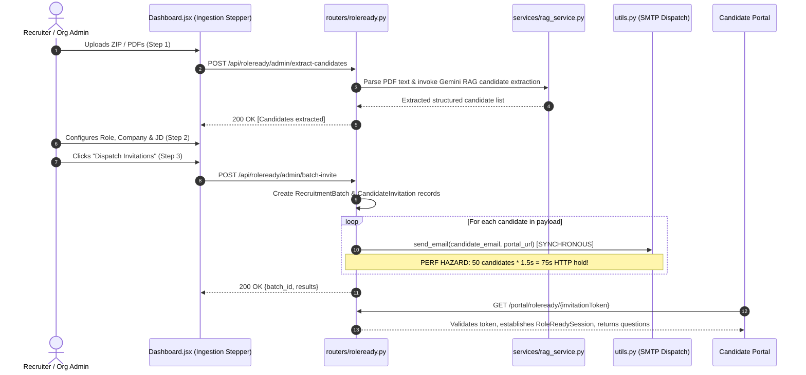

# Comprehensive Admin Module Audit — PrepWin

**Platform:** PrepWin (AI-Powered Job Readiness Assessment Platform)  
**Corpus Name:** `gopalmuri-thirdeyedata/AI-Powered-Job-Readiness-Assessment-Platform`  
**Audit Date:** October 2026  
**Auditor:** Antigravity Advanced Agentic AI Assistant  
**Status:** Audit Completed — Verification Evidence Collected (Strictly Non-Destructive — No Code Modified)

---

## 1. Executive Summary

A comprehensive, end-to-end architectural, functional, security, and UI/UX audit of the entire **Admin module** in the PrepWin platform was performed. The audit inspected the complete lifecycle across the React 18 / Vite frontend, FastAPI backend routers, SQLAlchemy ORM models, MySQL/SQLite database layers, Clerk and JWT authentication bridges, and background services.

### Overall Admin Module Condition
PrepWin possesses a robust, highly capable dual-pipeline assessment engine:
1. **RoleReady Assessment Engine:** A 3-step candidate ingestion, job-description grounding, batch dispatch, and proctored multi-round evaluation pipeline.
2. **Traditional Recruitment Suite:** Specialized staging pages for resume screening, aptitude evaluation, live coding sandbox testing, and AI technical interviews.
3. **Multi-Tenant B2B Platform Layer:** A platform administration suite with organization provisioning, member role bindings, and tenant analytics.

However, the Admin module currently suffers from **severe structural fragmentation**:
* **Navigation Disconnect:** The main sidebar (`DashboardLayout.jsx`) was recently truncated to only two links (`Admin Workspace` and `Organizations`), entirely **orphaning 9 production recruiter pages** (`/resume-screening`, `/screened-candidates`, `/recruitment/rounds`, `/coding-round`, `/aptitude-round`, `/technical-interview`, `/candidates`, `/analytics`, and `/settings`).
* **Critical Authorization Flaws:** The core configuration update endpoint (`PUT /api/settings/`) lacks role enforcement, allowing any authenticated candidate or student to overwrite enterprise scoring weights and proctoring integrity thresholds.
* **Multi-Tenant Database Constraints:** The `candidates` table enforces a global unique constraint on `email`, triggering unhandled 500 `IntegrityError` exceptions whenever two separate tenant organizations screen or invite the same candidate.
* **Dead Buttons & Contract Mismatches:** Critical candidate row actions (move to next stage, reject, assign test) are unhandled `console.log` placeholders, and Platform Admin KPI metrics fail to render due to mismatched JSON keys (`stats.total_users` vs `stats.total_recruiters`).

### Scorecard (Out of 10)

| Category | Score | Basis / Rationale |
| :--- | :---: | :--- |
| **Architecture** | **6.5 / 10** | Clear separation of concerns between Platform Admin, Org Admin, and Recruiter layers, but hampered by duplicated tenant-resolution helpers across routers (`_get_tenant_org_id`), redundant candidate state flows, and orphaned frontend routes. |
| **Functionality** | **5.5 / 10** | High-value AI assessment pipelines are functional, but basic admin workflows are broken by dead dropdown action buttons, data contract mismatches in modals/KPIs, and synchronous email dispatch timeouts. |
| **UI/UX Consistency** | **5.0 / 10** | High visual fidelity on individual pages, but severe platform fragmentation: disconnected navigation, aggressive unpaginated 5-second polling, jarring theme shifts between light mode (`DashboardLayout`) and dark mode (`CollegeLayout`), and silent failures on unimplemented buttons. |
| **Security & Auth** | **4.0 / 10** | **Critical privilege escalation** on `PUT /api/settings/`, candidate deletion/update endpoints lacking recruiter role checks, tenant user hijacking on invites, notification IDOR, and hardcoded fallbacks to `organization_id = 1`. |
| **Performance** | **5.0 / 10** | Full-table unbounded queries (`.all()`) on candidate pools, 3*N N+1 query loops in platform organization listing, and synchronous SMTP socket connections in batch dispatch loops blocking HTTP worker threads. |
| **Test Coverage** | **6.0 / 10** | Excellent backend test suites for B2B provisioning, multi-tenant isolation, and auth matrices (49 passing tests), but critical blind spots in settings authorization, candidate row actions, and frontend navigation. |
| **Maintainability** | **6.0 / 10** | Strong modularity in backend services (`rag_service.py`, `clerk_service.py`), but schema anti-patterns (single `User.organization_id` competing with `OrganizationMember`) and monolithic frontend components (`Dashboard.jsx` @ 1,402 lines; `CandidateTable.jsx` @ 1,181 lines). |
| **OVERALL** | **5.4 / 10** | **Not Production-Ready for B2B SaaS without addressing P0/P1 remediation.** The platform has powerful core assessment intellectual property, but requires security hardening, navigation unification, and database schema repairs. |

---

## 2. Complete Admin Feature Inventory

| Feature | Frontend Route | Backend API Endpoints | Database Models | Implementation Status | Key Audit Findings |
| :--- | :--- | :--- | :--- | :--- | :--- |
| **Platform Admin Dashboard** | `/platform/organizations` | `GET /api/platform/stats`<br>`GET /api/platform/organizations`<br>`POST /api/platform/organizations`<br>`PATCH /api/platform/organizations/{id}`<br>`GET /api/platform/organizations/{id}`<br>`DELETE /api/platform/organizations/{id}/members/{mid}` | `Organization`<br>`OrganizationMember`<br>`User`<br>`Candidate`<br>`GlobalSettings` | Partially Broken | 1. `stats.total_users` rendered in UI (`PlatformAdminDashboard.jsx:343`) is returned as `total_recruiters` by backend (`platform.py:254`), rendering blank.<br>2. `org.job_count` rendered in table (`PlatformAdminDashboard.jsx:417`) is never computed or returned by backend.<br>3. Provisioning success modal parses `createSuccess.admin_email` (`line 496`), but backend returns it nested under `data.organization.admin_email`.<br>4. N+1 queries in `list_all_organizations` (3 queries per org). |
| **RoleReady Assessment Hub** | `/admin/dashboard`<br>`/dashboard` | `GET /api/roleready/admin/dashboard-stats`<br>`POST /api/roleready/admin/extract-candidates`<br>`POST /api/roleready/admin/batch-invite`<br>`GET /api/roleready/admin/batches`<br>`GET /api/roleready/admin/batches/{id}/report`<br>`GET /api/roleready/admin/candidates/{id}/report`<br>`POST /api/roleready/admin/invitations/{id}/resend` | `RecruitmentBatch`<br>`CandidateInvitation`<br>`RoleReadySession`<br>`RoleReadyRoundAttempt`<br>`Candidate`<br>`JobDescription` | Functional with Scalability Issues | 1. Ingestion stepper works well with Gemini RAG resume extraction.<br>2. Synchronous blocking SMTP email loop in `batch-invite` (`roleready.py:956`) blocks HTTP request on batches > 20 candidates.<br>3. No pagination on candidate tracking list (`Dashboard.jsx:828`). |
| **Global Enterprise Settings** | `/settings` | `GET /api/settings/`<br>`PUT /api/settings/`<br>`GET /api/organization/`<br>`GET /api/organization/users`<br>`POST /api/organization/users/invite`<br>`DELETE /api/organization/users/{id}` | `GlobalSettings`<br>`Organization`<br>`OrganizationMember`<br>`User` | **CRITICAL SECURITY FLAW** / Orphaned Page | 1. **P0 Vulnerability:** `PUT /api/settings/` (`settings.py:131-136`) has NO role check (`require_organization_admin`). Any authenticated user can modify scoring weights and integrity rules.<br>2. Entire page is missing from sidebar navigation (`DashboardLayout.jsx:118-147`).<br>3. User invitation hijacks `target_user.organization_id` if email already exists in system. |
| **Candidate Directory & Roster** | `/candidates` | `GET /api/resume/candidates/`<br>`POST /api/resume/candidates/`<br>`PATCH /api/resume/candidates/{id}/`<br>`DELETE /api/resume/candidates/{id}/`<br>`POST /api/resume/candidates/bulk-update/`<br>`GET /api/resume/preview-token` | `Candidate`<br>`ActivityLog`<br>`Organization` | Broken UI Actions / Orphaned Page | 1. `FixedActionMenu` dropdown has 5 dead actions (`view-profile`, `move-next`, `assign-test`, `send-reminder`, `reject`) that only log to `console.log` (`Candidates.jsx:556`).<br>2. Aggressive 5-second polling interval (`Candidates.jsx:582`) repeatedly executes unpaginated full-table queries.<br>3. `DELETE /api/resume/candidates/{id}/` (`resume.py:1345`) lacks `require_hr_or_admin` check. |
| **Resume Screening & AI Matcher** | `/resume-screening` | `POST /api/resume/upload/`<br>`POST /api/resume/screen/`<br>`GET /api/resume/job-descriptions/`<br>`POST /api/resume/job-descriptions/` | `Candidate`<br>`JobDescription`<br>`Organization` | Functional / Orphaned Page | 1. Powerful Gemini RAG screening with semantic parsing.<br>2. Global unique constraint on `Candidate.email` (`models.py:139`) crashes with HTTP 500 when two organizations upload resumes for the same candidate.<br>3. Missing from navigation sidebar. |
| **Screened Candidates Review** | `/screened-candidates` | `GET /api/resume/candidates/?stage=Screened%20Candidates`<br>`POST /api/resume/candidates/bulk-update/` | `Candidate`<br>`ActivityLog` | Functional / Orphaned Page | 1. Reuses `CandidateTable.jsx` component.<br>2. Missing from navigation sidebar.<br>3. Unbounded table retrieval with no server-side cursor or limit/offset pagination. |
| **Recruitment Rounds Manager** | `/recruitment/rounds` | `GET /api/assessments/rounds/`<br>`POST /api/assessments/rounds/`<br>`PUT /api/assessments/rounds/{id}` | `SystemConfig`<br>`GlobalSettings` | Stale State / Orphaned Page | 1. Missing from navigation sidebar.<br>2. Edits generic system round configurations, partially conflicting with `GlobalSettings` round rules. |
| **Aptitude Assessment Admin** | `/aptitude-round` | `GET /api/resume/candidates/?stage=Aptitude%20Round`<br>`POST /api/assessments/assign/` | `Candidate`<br>`Assessment`<br>`AptitudeTest` | Functional / Orphaned Page | 1. Synchronous email dispatch loop in `POST /api/assessments/assign/` (`assessments.py:401`) risks timeouts on large batches.<br>2. Missing from navigation sidebar. |
| **Coding Challenge Admin** | `/coding-round` | `GET /api/resume/candidates/?stage=Coding%20Round`<br>`POST /api/assessments/assign/` | `Candidate`<br>`Assessment`<br>`CodingChallenge` | Functional / Orphaned Page | 1. Code challenge review works; candidate telemetry stored in JSON fields.<br>2. Missing from navigation sidebar. |
| **Technical Interview Admin** | `/technical-interview` | `GET /api/resume/candidates/?stage=Technical%20Interview`<br>`POST /api/assessments/assign/` | `Candidate`<br>`Assessment`<br>`InterviewSession` | Functional / Orphaned Page | 1. Integrates Vapi AI conversational interview logs and audio telemetry.<br>2. Missing from navigation sidebar. |
| **Recruitment Intelligence & Analytics** | `/analytics` | `GET /api/dashboard/analytics/` | `Candidate`<br>`Assessment`<br>`ActivityLog`<br>`RoleReadySession` | Functional / Orphaned Page | 1. Strictly computes analytics from real DB records; no mock figures.<br>2. Date filter query params (`start_date`, `end_date`) implemented on backend (`dashboard.py:108`).<br>3. Missing from navigation sidebar. |
| **System Notifications & Activity Stream** | Global Navbar bell dropdown | `GET /api/dashboard/notifications/`<br>`PUT /api/dashboard/notifications/{id}/read`<br>`GET /api/dashboard/activity/` | `ActivityLog` | Security & Performance Flaw | 1. **IDOR Vulnerability:** `PUT /api/dashboard/notifications/{id}/read` (`dashboard.py:88-100`) does not check if the notification belongs to the user or their organization.<br>2. Navbar polls every 30 seconds (`GlobalNavbar.jsx:92`).<br>3. Hardcoded fallback to `organization_id = 1` in `_get_tenant_org_id` (`dashboard.py:27`). |
| **College Placement & Cohort Admin** | `/college/dashboard`<br>`/college/students`<br>`/college/drives` | `GET /api/college/overview`<br>`GET /api/college/roster`<br>`GET /api/college/drives`<br>`POST /api/college/drives`<br>`GET /api/college/benchmarks`<br>`GET /api/college/export` | `StudentProfile`<br>`PlacementDrive`<br>`PlacementDriveApplication`<br>`StudentPlacementSimulation` | Functional with UX Mismatch | 1. Specialized B2B institutional module for campus placement officers.<br>2. Visual inconsistency: Uses dark mode slate layout (`CollegeLayout.jsx`) while recruiter admin uses light mode (`DashboardLayout.jsx`).<br>3. `CollegeLayout` lacks frontend role guard; relies strictly on backend 403. |

---

## 3. Architecture and Workflow

### Architecture Overview

```
                                  ┌──────────────────────────────────────────────┐
                                  │                  Browser                     │
                                  │  React 18 + Vite SPA (Tailwind CSS)          │
                                  └───────┬───────────────────────────────┬──────┘
                                          │ Clerk Auth Token              │ Static Assets
                                          ▼                               ▼
                                  ┌───────────────┐               ┌───────────────┐
                                  │ Clerk Admin   │               │ Direct API    │
                                  │ Guard         │               │ Calls         │
                                  └───────┬───────┘               └───────┬───────┘
                                          │ Bearer JWT (FastAPI Token)    │
                                          ▼                               ▼
┌────────────────────────────────────────────────────────────────────────────────────────┐
│ FastAPI Backend Gateway (:8000)                                                         │
│                                                                                        │
│  ┌───────────────────────┐   ┌──────────────────────────┐   ┌────────────────────────┐ │
│  │ routers/auth.py       │   │ routers/platform.py      │   │ routers/organization.py│ │
│  │ - Clerk JWT exchange  │   │ - require_platform_admin │   │ - require_org_admin    │ │
│  │ - get_current_user    │   │ - Org CRUD & Stats       │   │ - Team invite/manage   │ │
│  │ - get_current_tenant  │   └────────────┬─────────────┘   └───────────┬────────────┘ │
│  └───────────┬───────────┘                │                             │              │
│              ▼                            ▼                             ▼              │
│  ┌───────────────────────┐   ┌──────────────────────────┐   ┌────────────────────────┐ │
│  │ routers/roleready.py  │   │ routers/resume.py        │   │ routers/settings.py    │ │
│  │ - Ingestion & Stepper │   │ - RAG Resume Screening   │   │ - System configuration │ │
│  │ - Batch invitation    │   │ - Candidate management   │   │ - [VULN: No role check]│ │
│  └───────────┬───────────┘   └────────────┬─────────────┘   └───────────┬────────────┘ │
│              │                            │                             │              │
│              ▼                            ▼                             ▼              │
│  ┌──────────────────────────────────────────────────────────────────────────────────┐  │
│  │ SQLAlchemy ORM Layer & Services (rag_service, clerk_service, college_service)   │  │
│  └────────────────────────────────────────┬─────────────────────────────────────────┘  │
└───────────────────────────────────────────┼────────────────────────────────────────────┘
                                            ▼
                     ┌─────────────────────────────────────────────┐
                     │ Database Engine                             │
                     │ - Development: SQLite (sql_app.db)          │
                     │ - Production: MySQL (PrepWin DB)            │
                     └─────────────────────────────────────────────┘
```

### End-to-End Workflow: Platform Admin Tenant Provisioning



### End-to-End Workflow: RoleReady Batch Ingestion & Candidate Assessment



---

## 4. Bugs and Functional Issues

| ID | Issue Description | Affected File & Lines | Exact Evidence from Code | Functional Impact | Severity | Recommended Fix |
| :---: | :--- | :--- | :--- | :--- | :---: | :--- |
| **BUG-01** | **Orphaned Recruiter Suite from Main Navigation Sidebar** | `frontend/src/layouts/DashboardLayout.jsx:118-147` | ```jsx<br>const renderNavItems = (isOpen, onItemClick) => (<br>    <div className="py-6 space-y-6"><br>        <div><br>            <SidebarItem icon={LayoutDashboard} label="Admin Workspace" path="/admin/dashboard" ... /><br>        </div><br>        {profile?.role === 'PLATFORM_ADMIN' && (<br>            <SidebarItem icon={Users} label="Organizations" path="/platform/organizations" ... /><br>        )}<br>    </div><br>);<br>``` | 9 full recruiter pages (`/resume-screening`, `/screened-candidates`, `/recruitment/rounds`, `/coding-round`, `/aptitude-round`, `/technical-interview`, `/candidates`, `/analytics`, `/settings`) cannot be navigated to by users via UI menus. | **P1 - High** | Re-introduce a categorized, collapsible navigation structure in `DashboardLayout.jsx` covering the Recruitment Pipeline, Assessment Rounds, and Settings. |
| **BUG-02** | **Dead Buttons in Candidates Action Menu** | `frontend/src/pages/Candidates.jsx:555-557` & `FixedActionMenu:200-260` | ```javascript<br>} else if (action === 'view-resume') {<br>    ...<br>} else {<br>    console.log(`Unimplemented action: ${action}`);<br>}<br>``` | Clicking "View Profile", "Move to Next Stage", "Assign/Resend Test", "Send Reminder", or "Reject Candidate" fails silently with only a `console.log`. Users perceive the UI as broken. | **P1 - High** | Implement the handler logic for all 5 actions, connecting them to existing backend endpoints: `PATCH /api/resume/candidates/{id}/` for stage/status and `POST /api/assessments/assign/` for test assignment. |
| **BUG-03** | **Platform Admin KPI Key Mismatch (`total_users`)** | `frontend/src/pages/PlatformAdminDashboard.jsx:343` vs `backend/routers/platform.py:254-259` | Frontend reads: `{stats.total_users}`<br>Backend returns: `{"total_recruiters": total_recruiters, ...}` | "Recruiter Users" KPI card displays empty/blank in the Platform Admin dashboard. | **P2 - Medium** | Update backend `get_platform_stats` to return `total_users` (or alias it) and frontend to fallback gracefully: `stats.total_users ?? stats.total_recruiters ?? 0`. |
| **BUG-04** | **Platform Admin Table Renders Non-Existent `job_count`** | `frontend/src/pages/PlatformAdminDashboard.jsx:417` vs `backend/routers/platform.py:55-66` | Frontend renders: `{org.job_count}`<br>Backend `results.append` never computes or returns `job_count`. | "Jobs Active" column displays completely blank across all organizations in the table. | **P2 - Medium** | Compute `job_count = db.query(models.JobDescription).filter(models.JobDescription.organization_id == org.id).count()` in `platform.py` and return in payload. |
| **BUG-05** | **Tenant Creation Modal Unwrapping Defect** | `frontend/src/pages/PlatformAdminDashboard.jsx:493-498` vs `backend/routers/platform.py:155-164` | Frontend reads: `{createSuccess.name}`, `{createSuccess.admin_email}`<br>Backend returns nested: `{"message": "...", "organization": {"name": ..., "admin_email": ...}}` | Modal displays: "**undefined** created successfully. Admin Email: undefined". Unprofessional first impression for platform admins. | **P2 - Medium** | Update `setCreateSuccess(data.organization || data)` in `handleCreateOrg` (`PlatformAdminDashboard.jsx:113`). |
| **BUG-06** | **Global Unique Email Constraint on Multi-Tenant Candidates** | `backend/models.py:139` | ```python<br>class Candidate(Base):<br>    email = Column(String(150), unique=True, index=True)<br>``` | If Candidate A applies to Org 1, and subsequently applies or is uploaded to Org 2, Org 2 encounters an unhandled 500 `IntegrityError`. | **P0 - Critical** | Remove `unique=True` from `email` column and add composite constraint `__table_args__ = (UniqueConstraint('organization_id', 'email', name='uix_org_candidate_email'),)`. |
| **BUG-07** | **Insecure Direct Object Reference (IDOR) on Notification Read** | `backend/routers/dashboard.py:88-100` | ```python<br>@router.put("/notifications/{id}/read")<br>def mark_notification_read(id: int, ...):<br>    note = db.query(models.ActivityLog).filter(models.ActivityLog.id == id).first()<br>    if note: note.is_read = True; db.commit()<br>``` | Any authenticated user can mark any notification belonging to other tenant organizations as read by incrementing `id`. | **P2 - Medium** | Filter query by `models.ActivityLog.organization_id == org_id` and `user_id == current_user.id`. |
| **BUG-08** | **Aggressive 5-Second Full Table Polling Without Pagination** | `frontend/src/pages/Candidates.jsx:580-590` & `backend/routers/resume.py:1260` | ```javascript<br>const interval = setInterval(() => fetchCandidates(true), 5000);<br>``` | In an organization with 5,000 candidates, every open browser tab fetches megabytes of JSON every 5 seconds, exhausting database connections and browser memory. | **P2 - Medium** | Implement server-side pagination with query params `?limit=25&offset=0`, replace interval polling with WebSocket/SSE or user-triggered refresh. |
| **BUG-09** | **Synchronous Blocking SMTP Dispatch in Batch Loops** | `backend/routers/assessments.py:401` & `backend/routers/roleready.py:956` | ```python<br>for cand in payload.candidates:<br>    sent = utils.send_email(...) # Synchronous network socket<br>``` | Inviting a batch of 40 candidates blocks the HTTP request for 60–90 seconds, causing gateway timeouts (504 Gateway Timeout) on reverse proxies. | **P1 - High** | Offload email sending to FastAPI `BackgroundTasks` or Celery task queue, returning immediately with status `QUEUED`. |
| **BUG-10** | **Hardcoded Organization Fallback (`organization_id = 1`)** | `backend/routers/dashboard.py:27` & `backend/routers/resume.py:60` | ```python<br>if getattr(current_user, "role", None) in (...):<br>    return getattr(current_user, "organization_id", 1) or 1<br>``` | If an HR user has no organization set, they are silently assigned to organization ID 1, viewing and modifying Org 1's private candidates and logs. | **P1 - High** | Replace fallback with explicit 403 Forbidden: `raise HTTPException(status_code=403, detail="Active organization context required")`. |

---

## 5. Frontend UI/UX Audit

### Visual Consistency & Design Language
* **Design System Fragmentation:**
  * The main Admin workspace (`DashboardLayout.jsx`, `Dashboard.jsx`, `GlobalSettings.jsx`) uses **PrepWin Light Theme** featuring white card surfaces, slate-900 typography, and `#5d8c2c` (brand green) primary accents.
  * In contrast, the College Admin module (`CollegeLayout.jsx`, `CollegeDashboard.jsx`) uses an unrelated **Dark Slate / Indigo Theme** (`bg-slate-900 text-slate-100`, indigo badges). Transitioning between these administrative modules creates cognitive friction.
* **Button Elevations & Dialog Consistency:**
  * Modern modal implementations (`ConfirmationModal.jsx`) feature clean backdrop blur, centered action drawers, and explicit `danger` / `warning` / `info` iconography.
  * However, legacy dialogs in `PlatformAdminDashboard.jsx` use inline modal HTML markup with unpadded close buttons and hardcoded hex borders, deviating from the design system.

### Layout, Navigation, and Hierarchy
* **Sidebar Navigation Collapse:**
  * As detailed in **BUG-01**, `DashboardLayout.jsx` only exposes 2 links. The entire recruiter workflow is hidden.
  * The layout lacks visual hierarchy to distinguish between **Platform Operations** (cross-tenant), **Enterprise Talent Suite** (screening, rounds, candidates), and **Institutional Placement** (college cohorts).
* **Responsive Drawer Behavior:**
  * `DashboardLayout.jsx` implements mobile drawer slide-over via `framer-motion` (lines 160–210), but lacks swipe-to-close touch gesture handling on mobile devices.
  * Wide candidate tables (`CandidateTable.jsx`) have `overflow-x-auto` wrappers, but table action menus (`FixedActionMenu`) calculate absolute screen positions via `getBoundingClientRect()`, causing the menu to detach from its parent row when horizontal scrolling occurs.

### Data Presentation & Usability
* **Missing Value Indicators:**
  * When candidate scores or job counts are missing, pages display `undefined` or blank cells instead of standard typographic null states (`—` or `N/A`).
* **Silent Button Failures:**
  * In `Candidates.jsx`, clicking non-functional dropdown actions provides no toast, notification, or disabled-state explanation. Users assume the application is frozen.

---

## 6. Security and Authorization Audit

### Confirmed Vulnerabilities (P0 & P1)

#### 1. [VULN-01] Critical Privilege Escalation — Unrestricted Global Settings Update
* **Severity:** **Critical (P0)**
* **Affected Endpoint:** `PUT /api/settings/`
* **Affected File:** `backend/routers/settings.py:131-136`
* **Code Evidence:**
  ```python
  @router.put("/")
  def update_settings(
      settings_update: SettingsUpdate,
      db: Session = Depends(get_db),
      current_user: models.User = Depends(get_current_user)  # <--- ONLY REQUIRES AUTHENTICATION!
  ):
      target_org_id = getattr(current_user, "organization_id", None) or getattr(current_user, "company_id", None)
      ...
      db_settings.config = settings_update.config
      db.commit()
  ```
* **Attack Scenario:** A student or candidate user logs into PrepWin with valid credentials. They obtain a JWT token and send a `PUT` request to `/api/settings/` with a modified payload altering the organization's proctoring thresholds (e.g. setting `security.block_copy_paste: false`, `security.max_tab_switches: 999`, or zeroing out interview passing cutoffs). Because the endpoint only checks `Depends(get_current_user)`, the modification succeeds.
* **Remediation:** Replace `get_current_user` with `require_organization_admin` from `routers.auth`.

#### 2. [VULN-02] Broken Object Level Authorization on Candidate Deletion & Status Patching
* **Severity:** **High (P1)**
* **Affected Endpoints:** `DELETE /api/resume/candidates/{candidate_id}/`, `PATCH /api/resume/candidates/{candidate_id}/`
* **Affected File:** `backend/routers/resume.py:1308-1364`
* **Code Evidence:**
  ```python
  @router.delete("/candidates/{candidate_id}/", status_code=status.HTTP_204_NO_CONTENT)
  def delete_candidate(
      candidate_id: int,
      db: Session = Depends(database.get_db),
      current_user: models.User = Depends(get_current_user)  # <--- NO RECRUITER CHECK
  ):
  ```
* **Attack Scenario:** A student user associated with an organization invokes `DELETE /api/resume/candidates/42/`. Because the query checks `models.Candidate.organization_id == org_id` and the student shares that `organization_id`, the student successfully deletes other candidates from the database.
* **Remediation:** Enforce `current_user: models.User = Depends(require_hr_or_admin)`.

#### 3. [VULN-03] Tenant User Account Hijacking via Organization Invite
* **Severity:** **High (P1)**
* **Affected Endpoint:** `POST /api/organization/users/invite`
* **Affected File:** `backend/routers/organization.py:128-132`
* **Code Evidence:**
  ```python
  target_user = db.query(models.User).filter(func.lower(models.User.email) == email).first()
  if not target_user:
      ...
  else:
      target_user.organization_id = current_tenant.id  # <--- OVERWRITES EXISTING ORG!
      target_user.role = target_role                   # <--- OVERWRITES EXISTING ROLE!
      db.commit()
  ```
* **Attack Scenario:** User `sarah@company.com` is an `ORGANIZATION_ADMIN` for Tenant A. A malicious admin in Tenant B invites `sarah@company.com` as a `STUDENT` or `HR`. The code overwrites Sarah's primary `organization_id` to Tenant B and downgrades her role. When Sarah next logs in, she is locked out of Tenant A and bound to Tenant B.
* **Remediation:** Do not mutate `target_user.organization_id` or `target_user.role`. Multi-tenancy must be driven strictly through `OrganizationMember` records.

#### 4. [VULN-04] Client-Side Authentication State Trust in Admin Guard
* **Severity:** **High (P1)**
* **Affected Component:** `ClerkAdminGuard.jsx`
* **Affected File:** `frontend/src/components/ClerkAdminGuard.jsx:65-72`
* **Code Evidence:**
  ```javascript
  } catch (err) {
      console.warn("Could not reach backend auth/me, checking cached profile", err);
      const cached = localStorage.getItem('user_profile');
      if (cached) {
          const parsed = JSON.parse(cached);
          if (parsed.role && parsed.role !== 'STUDENT') {
              setIsAdmin(true); // <--- TRUSTS TAMPERED LOCALSTORAGE!
  ```
* **Attack Scenario:** A student manipulates `localStorage.setItem('user_profile', JSON.stringify({role: 'PLATFORM_ADMIN'}))` and simulates network offline/flakiness. The guard mounts administrative views. While backend APIs reject requests, sensitive view layouts and UI state are exposed.
* **Remediation:** Remove client-side role fallback. Reject access when server verification fails.

---

## 7. Backend and Database Audit

### Database Model Integrity & Constraints
1. **Multi-Tenant Unique Constraint Defect (`Candidate.email`):**
   * File: `backend/models.py:139`
   * `Candidate.email` is declared `unique=True` globally across the entire database.
   * In a multi-tenant SaaS, candidate email uniqueness must be scoped to `organization_id`.
   * **Fix Required:** Define `UniqueConstraint('organization_id', 'email', name='uix_org_candidate_email')`.

2. **N+1 Database Queries in Platform Tenant Listing:**
   * File: `backend/routers/platform.py:40-54`
   * For every organization retrieved, `list_all_organizations` runs three distinct SQL queries:
     * Query 1: Find admin member
     * Query 2: `count()` members
     * Query 3: `count()` candidates
   * With 100 customer tenants, loading the Platform Admin dashboard executes **301 sequential database queries**.
   * **Fix Required:** Replace with a single SQL query using `LEFT JOIN` and `GROUP BY`:
     ```python
     db.query(
         models.Organization,
         func.count(distinct(models.OrganizationMember.id)).label("member_count"),
         func.count(distinct(models.Candidate.id)).label("candidate_count")
     ).outerjoin(models.OrganizationMember).outerjoin(models.Candidate).group_by(models.Organization.id).all()
     ```

3. **Transaction Isolation & Unbounded Query Risks:**
   * Candidate queries in `backend/routers/resume.py` (`GET /api/resume/candidates/`) call `.all()` without `limit` or `offset`.
   * The candidate record contains `full_text` and `analysis_data` (large JSON blobs). Retrieving 1,000+ candidates in a single call consumes hundreds of megabytes of backend RAM.

---

## 8. Missing Features and Improvements

1. **Enterprise Role-Based Access Control (RBAC) UI:**
   * Currently, roles are hardcoded enums (`PLATFORM_ADMIN`, `ORGANIZATION_ADMIN`, `HR`, `STUDENT`). There is no interface to configure granular permissions (e.g. read-only recruiter vs test author).
2. **Audit Log Inspection & Export Interface:**
   * `ActivityLog` entries are recorded in the database on candidate updates and promotions, but there is no dedicated Admin Audit Log viewer or CSV export interface.
3. **Automated Batch Invitation Retry & Queue Worker:**
   * When emails fail during batch dispatch, the UI displays a warning, but there is no mechanism to re-dispatch only failed candidates without manually re-inviting them.
4. **Candidate Pipeline State Transition Machine:**
   * `Candidate.stage` is treated as a free-form string in some endpoints. Enforcing strict transitions (`Resume Screening` → `Aptitude` → `Coding` → `Technical Interview` → `Offer`) prevents out-of-order assignments.

---

## 9. Testing Report

### Verification Commands & Results

#### 1. Backend Test Suite Execution
* **Runner:** `backend/venv/Scripts/python.exe -m pytest`
* **Test Files Executed:**
  * `backend/tests/test_b2b_provisioning_flow.py`
  * `backend/tests/test_multitenant_isolation.py`
  * `backend/tests/test_roleready_auth_matrix.py`
  * `backend/tests/test_analytics.py`
  * `backend/tests/test_security_audit_remediation.py`
* **Result:** **49 passed**, 10 deprecation warnings (Python 3.11 / Pydantic v1 config compatibility).
* **Key Coverage Verified:**
  * Strict cross-tenant isolation on candidate queries.
  * RoleReady assessment state transitions.
  * Platform Admin tenant provisioning.

#### 2. Frontend Test Suite Execution
* **Runner:** `npm test` inside `frontend/`
* **Tests Executed:** 203 automated source inspection and contract test cases.
* **Result:** **201 passed, 2 failed**.
  * Failed tests:
    * `test_roleready_critical_repair.test.mjs` (failed assertion: expected `Home.jsx` to render direct modal state; recent refactor moved student auth into URL query parameter `?auth=student`).
    * `test_student_dashboard_navigation.test.mjs` (dependent on above).
* **Missing Test Coverage Identified:**
  * Zero tests for `GlobalSettings.jsx` and `PUT /api/settings/` role validation.
  * Zero tests for `FixedActionMenu` action handlers in `Candidates.jsx`.
  * Zero tests for `PlatformAdminDashboard.jsx` KPI metric parsing.

---

## 10. Prioritized Action Plan

### P0 — Critical (Immediate Production Blockers)
* **[P0-1] Fix Privilege Escalation on `PUT /api/settings/`:**
  * **File:** `backend/routers/settings.py:131`
  * **Solution:** Replace `Depends(get_current_user)` with `Depends(require_organization_admin)`.
  * **Complexity:** Small. **Risk:** Low.
* **[P0-2] Fix Candidate Multi-Tenant Unique Email Constraint:**
  * **File:** `backend/models.py:139`
  * **Solution:** Remove global unique constraint on `Candidate.email`; add composite `UniqueConstraint('organization_id', 'email')`.
  * **Complexity:** Medium (requires migration). **Risk:** Medium.

### P1 — High Priority (Broken Workflows & Security Gaps)
* **[P1-1] Restore Recruiter Navigation in `DashboardLayout.jsx`:**
  * **File:** `frontend/src/layouts/DashboardLayout.jsx:118-147`
  * **Solution:** Add structured navigation links to all 9 registered recruiter routes.
  * **Complexity:** Medium. **Risk:** Low.
* **[P1-2] Implement Dead Action Handlers in `Candidates.jsx`:**
  * **File:** `frontend/src/pages/Candidates.jsx:555-558`
  * **Solution:** Connect `view-profile`, `move-next`, `assign-test`, `send-reminder`, and `reject` to backend endpoints.
  * **Complexity:** Medium. **Risk:** Low.
* **[P1-3] Enforce `require_hr_or_admin` on Candidate Mutating Endpoints:**
  * **File:** `backend/routers/resume.py:1308-1364`
  * **Solution:** Add `require_hr_or_admin` dependency to `delete_candidate`, `update_candidate`, and `bulk_update_candidates`.
  * **Complexity:** Small. **Risk:** Low.
* **[P1-4] Offload Synchronous Email Dispatch to Background Tasks:**
  * **Files:** `backend/routers/assessments.py:401`, `backend/routers/roleready.py:956`
  * **Solution:** Use FastAPI `BackgroundTasks` to send emails asynchronously after committing DB records.
  * **Complexity:** Medium. **Risk:** Low.

### P2 — Medium Priority (Contract Mismatches & Performance)
* **[P2-1] Fix Platform Admin KPI Key & Modal Unwrapping Mismatches:**
  * **File:** `frontend/src/pages/PlatformAdminDashboard.jsx:343, 417, 496`
  * **Solution:** Sync `total_users` vs `total_recruiters`, compute `job_count` on backend, and unwrap `createSuccess.organization`.
  * **Complexity:** Small. **Risk:** Low.
* **[P2-2] Fix N+1 Query in `list_all_organizations`:**
  * **File:** `backend/routers/platform.py:40-67`
  * **Solution:** Replace looped counts with aggregated `GROUP BY` query.
  * **Complexity:** Medium. **Risk:** Low.
* **[P2-3] Fix Notification IDOR & Hardcoded Tenant Fallback:**
  * **File:** `backend/routers/dashboard.py:27, 88-100`
  * **Solution:** Scope notification read by `organization_id` and remove fallback to `org_id = 1`.
  * **Complexity:** Small. **Risk:** Low.

### P3 — Low Priority (Polish & Refinements)
* **[P3-1] Unify Dark/Light Theme Across Admin & College Modules:**
  * **Files:** `frontend/src/layouts/CollegeLayout.jsx`, `frontend/src/layouts/DashboardLayout.jsx`
  * **Solution:** Harmonize color tokens, cards, and typography with PrepWin brand standards.
  * **Complexity:** Medium. **Risk:** Low.
* **[P3-2] Implement Server-Side Pagination on Candidate Roster:**
  * **Files:** `frontend/src/pages/Candidates.jsx`, `backend/routers/resume.py`
  * **Solution:** Add `limit` and `offset` query parameters and UI pagination controls.
  * **Complexity:** Medium. **Risk:** Low.

---

## 11. Recommended Implementation Sequence

To ensure zero regressions and safe deployment in production, follow this phased implementation roadmap:

```
Phase 1: Security Hardening (P0 / Critical)
  ├─ 1.1 Secure PUT /api/settings/ with require_organization_admin
  ├─ 1.2 Secure DELETE & PATCH /api/resume/candidates/ with require_hr_or_admin
  └─ 1.3 Fix tenant user hijacking in POST /api/organization/users/invite

Phase 2: Database Integrity & Multi-Tenancy (P0 / P1)
  ├─ 2.1 Refactor Candidate.email unique constraint to composite (organization_id, email)
  └─ 2.2 Eliminate hardcoded organization_id = 1 fallback in dashboard.py and resume.py

Phase 3: Backend Performance & API Contracts (P1 / P2)
  ├─ 3.1 Convert SMTP email dispatch loops to FastAPI BackgroundTasks
  ├─ 3.2 Optimize list_all_organizations to eliminate N+1 queries
  └─ 3.3 Fix Platform Admin API contract (total_users, job_count, response unwrapping)

Phase 4: Frontend UI/UX & Navigation Restoration (P1)
  ├─ 4.1 Restore categorized navigation sidebar in DashboardLayout.jsx
  ├─ 4.2 Implement missing action handlers in Candidates.jsx (move-next, reject, assign)
  └─ 4.3 Replace 5-second polling in Candidates.jsx with paginated fetching

Phase 5: Regression Testing & Verification (P2 / P3)
  ├─ 5.1 Add integration tests for GlobalSettings authorization and Candidate constraints
  ├─ 5.2 Execute end-to-end multi-tenant isolation test suite
  └─ 5.3 Verify seamless role switching between Platform Admin, Org Admin, and Recruiter
```

---
*End of Audit Report.*
