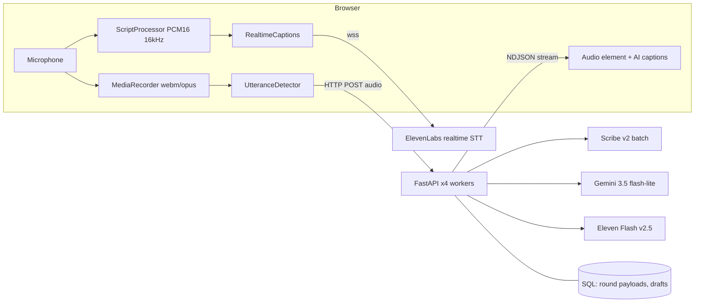

> **Superseded.** This is the first audit, written before most of the optimization work. The current, complete document is [interview-architecture.md](interview-architecture.md).

# AI Interview: Architecture Audit, Measured Baseline and Optimization Plan

Date of investigation: 2026-10-29. Scope: the voice interview used by the student self-assessment (`/api/roleready`) and the shared-link
assessment (`/api/public/assessment`). Both use the same engine.

**How to read this.** Every statement is tagged: **[verified]** = read in the code or returned by a real API call during this investigation,
**[measured]** = timed by me against the live services (numbers and sample sizes given), **[official]** = taken from ElevenLabs' own pages fetched
today, **[estimate]** = my arithmetic from stated assumptions, **[unknown]** = not checked.

---

## 1. Executive summary

* The interview is a **cascaded pipeline**: browser records audio, sends it over one HTTP request, the server transcribes (ElevenLabs batch Scribe v2), asks Gemini for the next
  reply, and synthesizes each sentence with ElevenLabs Flash v2.5, streaming the results to the browser as newline-delimited JSON. Live captions use a **separate**
  ElevenLabs realtime Scribe v2 WebSocket opened by the browser with a single-use token. There is no WebRTC and no speech-to-speech.
* **Measured, one candidate at a time (n=6, server side):** audio in to the candidate's transcript p50 1.13 s / p95 1.75 s; audio in to the first AI audio chunk p50 2.81 s /
  p95 3.61 s. On top of that the browser deliberately waits **1.8 to 4.0 s of silence** before it sends an answer (by design, to avoid cutting people off).
* **The largest controllable latencies** are (1) batch speech-to-text on the critical path (about 1.1 to 1.4 s), (2) Gemini time to first token (about 1.2 to 1.3 s; every
  Gemini candidate I could test is in the same range), (3) non-streaming TTS (0.57 s full response vs 0.36 s to first byte when streamed).
* **The proposed target "end of turn to first audible response p95 <= 1.5 s" is not reachable with this pipeline** (STT + LLM alone are about 2.4 s). A defensible target is
  in section 11.
* **20 simultaneous turns completed 20 of 20** in both runs. With the ElevenLabs concurrency settings we ship today (1 TTS and 3 STT per process) the first audio took p50 9.4 s / p95 14.2 s
  in a single process; with settings sized to the plan (6 TTS, 12 STT) it was p50 3.8 s / p95 4.8 s. **[measured]** Production runs 4 processes, so the real figure
  sits between the two; the settings should be re-derived from the plan (section 12).
* **The account is not upgraded as far as the API can tell:** `tier: "starter"`, `status: "active"`, no pending change. The earlier payment failure is resolved.
* **Recommendation:** keep the cascaded pipeline (hybrid variant). Do not move to the managed ElevenLabs agent now. Three highest-impact changes: stop waiting for batch STT
  (use the realtime transcript for the reply, keep batch STT for the scored record), stream TTS, and fix the concurrency settings/limits. Details in sections 8 and 15.

---

## 2. Verified current architecture

| Component | File / function | Role | Protocol |
|---|---|---|---|
| Voice session | `frontend/src/utils/voiceInterviewSession.js` `VoiceInterviewSession` | records, detects end of answer, plays replies, keeps `history` | MediaRecorder (webm/opus), `fetch` |
| End-of-answer detector | same file, `UtteranceDetector.push`, `endSilenceFor` | loudness-based; waits 1.8 / 2.2 / 4.0 s depending on the captions so far | in-browser |
| Live captions (candidate) | `frontend/src/utils/liveCaptions.js` `RealtimeCaptions` | streams 16 kHz mono PCM16 (ScriptProcessor) to ElevenLabs realtime STT | WebSocket (wss) direct to ElevenLabs |
| Fallback captions | same session file, browser `SpeechRecognition` | used when the realtime connection fails | browser API |
| Turn endpoint | `backend/routers/roleready.py:674` and `public_assessment.py:318` `voice-turn-stream` | NDJSON stream: `transcript`, `audio` chunks, `done` | HTTP POST, `application/x-ndjson` |
| Caption token | `.../voice-caption-token` -> `elevenlabs_service.realtime_caption_session` | single-use realtime token; the API key never reaches the browser | HTTPS |
| Turn engine | `backend/services/elevenlabs_service.py` `run_turn_stream` (568) | STT -> Gemini stream -> sentence chunks -> TTS, in order | HTTPS to ElevenLabs/Gemini |
| STT | `transcribe` (446), model `ELEVENLABS_STT_MODEL` = `scribe_v2` | batch, whole answer uploaded | HTTPS POST |
| TTS | `synthesize` (356), model `eleven_flash_v2_5`, `mp3_44100_64` | one request per sentence, **non-streaming** | HTTPS POST |
| LLM | `next_reply` (504) / `stream_gemini_text`, model `gemini-3.5-flash-lite`, thinking off, 256 max tokens | next spoken reply | HTTPS streaming |
| Interviewer prompt and state | `build_system_prompt` (163), `_interview_state` (263), `_answer_hint` (247) | adaptive rules, elapsed time, uncovered questions, follow-up count | prompt text |
| Concurrency lines | `_tts_line` / `_stt_line` (106-107) | bounded waiting line per process, 429 retry with jitter | in-process semaphores |
| Per-session limits | `voice_turn_limiter`, `caption_token_limiter` (`roleready_service.py:2803`, `assessment_flow_service.py:652`) | rate limit per session | in-process |
| Persistence | voice definition in the round's `server_keys_payload`; transcript saved at submit and in autosaved drafts | | DB |

Production runs **4 gunicorn/uvicorn workers** (`backend/Dockerfile`, CMD) behind nginx; `proxy_read_timeout` is 300 s on `/api/`.

### Sequence of one turn (current)

```mermaid
sequenceDiagram
    participant C as Candidate browser
    participant EL as ElevenLabs realtime STT (wss)
    participant API as Backend /voice-turn-stream
    participant ST as ElevenLabs Scribe v2 (batch)
    participant G as Gemini (stream)
    participant T as ElevenLabs TTS Flash v2.5
    C->>API: POST voice-caption-token
    API-->>C: single-use token
    C->>EL: wss + PCM16 16 kHz (while the candidate speaks)
    EL-->>C: partial_transcript / committed_transcript (live captions)
    Note over C: silence 1.8 / 2.2 / 4.0 s decides "answer finished" (intentional wait)
    C->>API: POST audio (webm/opus) + history
    API->>ST: upload whole answer
    ST-->>API: final transcript   (about 1.1 - 1.4 s)
    API-->>C: event transcript
    API->>G: history + status block + candidate text
    G-->>API: tokens (first token about 1.3 s)
    loop each sentence
        API->>T: synthesize(sentence)   (about 0.6 s, full response)
        T-->>API: mp3
        API-->>C: event audio (base64 mp3 + text)
    end
    API-->>C: event done
    C->>C: play mp3 chunks in order; AI caption follows audio duration
```

### Component diagram



### Verified facts about behaviour

* **No barge-in.** There is no interruption handling in `voiceInterviewSession.js`; the microphone is ignored while the AI speaks and for `REPLY_GUARD_MS` (350 ms)
  afterwards. **[verified]**
* **No server-side per-turn persistence.** Turns live in the browser `history`; the transcript reaches the database only through autosaved drafts and `submit-interview`
  (`assessment_flow_service.py:730, 797`, `roleready_service.py:2865-2880`). The server trusts the client-supplied `history` (`_clean_history`, capped at 30 turns and
  2,400 characters per turn). **[verified]** A refresh ends the sitting (e2e behaviour), so a lost browser loses the unsaved part of the conversation.
* **Rate limiters and the ElevenLabs waiting lines are per process.** With 4 workers the effective ceilings are 4x the configured numbers. **[verified]**
* **No WebRTC, no EventSource.** Audio to the server is a single upload per answer; audio back is base64 inside JSON lines; captions are over the ElevenLabs WebSocket. **[verified]**
* **Not checked:** whether any code persists raw audio (I found none but did not search exhaustively) **[unknown]**.

---

## 3. Measured baseline

Method: `scratchpad/latency_baseline.py` and `latency_part2.py`, run inside the production backend container against the live ElevenLabs and Gemini APIs, one 100-character
interviewer sentence and a synthesized 12 s spoken answer (ElevenLabs-generated speech, so this is **not** a human accent test). Sample sizes are small (6 to 8) and one
network location; treat p95 as indicative only, p99 not computed.

| Stage | Measurement | p50 | p95 | n |
|---|---|---|---|---|
| TTS Flash v2.5, full response (current usage) | request to complete mp3 | 0.571 s | 1.054 s | 8 |
| TTS Flash v2.5, `/stream` | first audio byte | 0.362 s | 0.393 s | 8 |
| TTS v4 Turbo, full response | request to complete mp3 | 1.105 s | 2.626 s | 8 |
| TTS v4 Turbo, `/stream` | first audio byte | 0.370 s | 0.426 s | 8 |
| STT Scribe v2 batch, 12 s answer | upload to final transcript | 1.444 s | 1.505 s | 6 |
| Gemini 3.5 flash-lite (current), streaming | time to first token | 1.319 s | 1.572 s | 8 |
| same | first speakable sentence / full reply | 1.411 s / 1.468 s | 1.633 s / 1.690 s | 8 |
| Our server turn, 1 candidate | request to transcript | 1.127 s | 1.754 s | 6 |
| same | request to FIRST AI AUDIO chunk | 2.806 s | 3.609 s | 6 |
| same | request to reply done | 3.184 s | 3.895 s | 6 |

Gemini alternatives (6 runs each, same prompt): `gemini-flash-lite-latest` TTFT p50 1.146 s; `gemini-2.5-flash` 1.272 s (p95 2.667 s); `gemini-3.5-flash` 2.741 s;
`gemini-2.5-flash-lite` returned HTTP 404 "no longer available to new users", so its row in my raw output is invalid (the client fell back to another model) and is excluded.
Conclusion: **no tested Gemini model beats the current one by a meaningful margin**; the floor is about 1.1 to 1.3 s.

**Not measured:** T0 to T3 and T10 to T11 (browser capture, caption latency, playback start, caption to audio offset) require browser instrumentation that does not exist yet.
Interim-caption latency (the vendor states about 150 ms for Scribe v2 Realtime **[official]**) and caption/audio synchronization are **unmeasured in our app**.

**Intentional waiting inside the budget:** end-of-answer silence 1.8 s (finished sentence) / 2.2 s (default) / 4.0 s (sentence left hanging) is a product choice, not processing time.

Approximate end-of-speech to first audible sound today **[estimate from the above]**: silence wait 2.2 s + server 2.8 s + upload/decode/playback start (not measured) = **about 5 s p50**.

---

## 4. Current ElevenLabs account and capabilities

Read from the real account (API key in the backend `.env`) on 2026-10-29:

* `GET /v1/user/subscription`: **tier `starter`, status `active`**, 74,334 character credits per month (292 used at the time of the call), voice limit 10,
  `pending_change: null`, no open invoices. The earlier `payment_issue` (HTTP 401 on TTS and STT) is resolved. **If you upgraded, the API does not show it**: confirm in the
  ElevenLabs billing page or check that this key belongs to the upgraded workspace. **[verified]**
* The key **lacks the `convai_read` permission** (agents list returned 401), so ElevenLabs Agents could not be inspected or tested with this key. **[verified]**
* `GET /v1/models` returns, among others: `eleven_v4`, `eleven_v4_turbo`, `eleven_v3`, `eleven_v3_conversational`, `eleven_flash_v2_5`, `eleven_turbo_v2_5`, `eleven_multilingual_v2`;
  `eleven_flash_v2_5` and `eleven_v4_turbo` have a credit cost multiplier of 0.5, `eleven_v4` 1.0. **[verified]**
* Official models page (fetched today): `scribe_v2_realtime` "Low latency (~150 ms)" with partial transcripts, VAD and manual commit control; `eleven_flash_v2_5` "~75 ms";
  `eleven_v4_turbo` "median inference latency of ~100 ms", recommended for Agents Platform; `eleven_v3_conversational` "~280 ms"; `scribe_v1` is **deprecated** (we already use `scribe_v2`);
  Eleven Realtime voice agent models `eleven_realtime_v1_mini` / `_max` are full agent configurations. The page notes its latency figures **exclude application and network latency**
  and use different metrics, so they are not directly comparable. **[official]** (My measured TTS first-byte times of 0.36 to 0.37 s include our network round trip and are consistent with that note.)
* Official API pricing page (USD, excluding tax) **[official]**: TTS v4 $0.08 / 1K characters; v4 Turbo $0.04; v3 Conversational $0.04; Flash/Turbo $0.04; Scribe v2 $0.22/hour;
  Scribe v2 Realtime $0.39/hour; Realtime v1 Mini/Max agents $0.08/minute plus LLM tokens (Mini $0.20 / $6.00 per 1M input/output tokens; Max $1.80 / $9.00), burst $0.16/minute above the concurrency limit.
  Plan table on that page: concurrent calls Free 4, Starter 6, Creator 10, Pro 20, Scale 30, Business 40 (the page does not label the rows by plan; mapping by order, Creator confirmed by its 275k-character line).
  The page also says API usage is billed in USD "not credits" while this account is on a credit plan: **how API usage is billed for this account is unresolved**.
* Not obtained: the dedicated concurrency/priority page (HTTP 403 on fetch) and any official statement of per-model concurrency for realtime STT. My earlier note of "realtime STT 9 on Starter"
  came from an earlier lookup and is **[unverified]** in this investigation. Agent transcript streaming details, barge-in controls and end-of-turn settings were **not** established
  (the agents overview page did not cover them) **[unknown]**.

---

## 5. Architecture comparison

| | A. Native speech-to-speech | B. Cascaded streaming (current) | C. Managed ElevenLabs agent | D. Hybrid (B + realtime STT text on the critical path) |
|---|---|---|---|---|
| Flow | mic -> S2S model -> speech | mic -> STT -> LLM -> TTS -> speaker | mic -> ElevenLabs agent (STT, turn-taking, LLM, TTS) | realtime STT text -> our LLM -> streamed TTS; batch STT only for the record |
| Captions | depends on the API exposing transcripts **[unknown]** | separate realtime STT (already built) | via agent events **[unknown whether partials are exposed]** | same as B |
| Our control of questions/state/evaluation | low | full | partial (prompt + tools) **[unknown depth]** | full |
| Interruptions | vendor-side | must build (none today) | vendor-side (built in) **[official overview mentions turn-taking/interruptions]** | must build |
| Latency (expected) | vendor claim only; not measured by me | measured 2.8 s server p50 + silence | not measured (key lacks permission) | estimate about 1.5 to 2 s server p50 (section 11) |
| Cost per 30-min interview | not priced | about $0.32 (section 13) | about $2.40 + LLM tokens | about $0.32 + a little |
| 20 concurrent | plan-dependent **[unknown]** | measured OK (20/20) | agent concurrency = plan "concurrent calls" (Starter 6) then burst at $0.16/min | as B |
| Complexity | high (new stack) | already running | medium, but loses our adaptive-state control | low to medium |

Interruption behaviour, cancellation and failure recovery for each option other than B are vendor-dependent and were not testable here; B is described in sections 6 and 9.

---

## 6. Live captions

Already built and verified in earlier work: candidate words appear word by word from `partial_transcript` (replaced by `committed_transcript`), AI captions are revealed in step
with each audio chunk's duration. Gaps against the brief: caption latency is **not measured**, AI captions are chunk-timed rather than word-aligned (ElevenLabs offers
character timestamps on TTS; not evaluated here), and an obsolete reply is not cancelled on interruption because there is no barge-in. Recommendation: add timing marks (section 14)
before changing anything.

---

## 7. Turn-taking and interruptions

* Today: loudness-based end detection with a caption-aware wait (1.8 / 2.2 / 4.0 s). It will not cut people off mid-thought, at the cost of about 2 s of unavoidable delay.
* A measurable alternative: use the realtime transcript's `committed_transcript` (the vendor's VAD with manual commit control **[official]**) as the end signal. Provisional target: fewer than
  3% of answers cut before the last word, measured on recorded test answers, then shorten the wait only if that holds.
* Barge-in: not implemented. If wanted: stop playback on candidate speech, abort the in-flight stream (the endpoint already uses an `AbortController` on the client), and drop
  late audio events with a turn counter. Needs a design decision because open-mic echo (the AI's own voice) must be separated first.

---

## 8. Recommended architecture

**Keep B, move to D.** Concretely:

1. **Critical-path text from the realtime stream.** Send the realtime `committed_transcript` with the audio. The server uses it to start Gemini immediately and still runs batch Scribe v2 in the
   background to store the scored transcript (replacing the client text). Saves about 1.1 to 1.4 s per turn **[estimate]**. If the realtime text is missing (connection refused/limit), fall back to today's path.
2. **Stream TTS** (`/text-to-speech/{voice}/stream`): first byte 0.36 s vs 0.57 s complete response **[measured]**; also send the first chunk as soon as it is ready.
3. **Re-derive concurrency from the plan** and move the limiters to a shared store (Redis is already deployed) so 4 workers share one budget.
4. Keep `gemini-3.5-flash-lite` (no tested alternative is meaningfully faster; `gemini-2.5-flash-lite` is gone for new users).
5. Keep Flash v2.5 for TTS. `eleven_v4_turbo` has the same `/stream` first-byte (0.37 s) and the same $0.04 price on the pricing page, with higher expressiveness claims; listen-test it before switching.
   Do not use `eleven_v4`/`eleven_v3` (not designed for the conversational loop; 2x price).
6. Do not adopt the managed agent yet: about 7x the per-interview cost, the API key has no agent permission, transcript/caption exposure is unverified, and our adaptive state
   (prepared-question coverage, time budget, evaluation hand-off) would need re-implementing as tools.

### Model table (identifiers verified on this account)

| Model id | Purpose | Streaming | Latency | Quality note | Price basis |
|---|---|---|---|---|---|
| `scribe_v2_realtime` | live captions, proposed critical-path text | WebSocket partial/committed | vendor ~150 ms **[official]**, not measured by me | per-session connection limit applies | $0.39/h **[official]** |
| `scribe_v2` | scored transcript (batch) | no | 1.44 s for 12 s audio **[measured]** | final record | $0.22/h **[official]** |
| `eleven_flash_v2_5` | interviewer voice | `/stream` | 0.36 s first byte, 0.57 s full **[measured]** | good, less expressive | $0.04 / 1K chars **[official]** |
| `eleven_v4_turbo` | candidate replacement voice | `/stream` | 0.37 s first byte, 1.1 s full **[measured]** | more expressive (vendor) | $0.04 / 1K chars **[official]** |
| `gemini-3.5-flash-lite` | interviewer LLM | streaming | TTFT 1.3 s **[measured]** | follows the prompt rules in my tests | not priced here |

---

## 9. Reliability and session handling (gaps found)

* No server-side per-turn log: a refresh or crash loses unsaved turns; late/duplicate events are not de-duplicated by sequence number. Propose a `turn_id` per exchange and an idempotent
  `INSERT` of (session, turn, user_text, reply_text, timings) at the end of each streamed turn.
* The server trusts the client `history`; a candidate can alter their own history or the transcript submitted at the end. Propose building history from the stored turns.
* Technical failures are shown as a connection error with Retry / written answer; they are not scored as candidate failure (earlier work), but a failed TTS (like the recent billing 401)
  surfaces as "Connection Failed" with no operator-visible alert. Propose a health probe and an admin banner.
* Abandoned sessions: the round deadline and the sweeper handle cleanup; per-session in-process rate limits are never persisted. **[verified]**

---

## 10. Security and privacy

* No ElevenLabs key in the browser: captions use a single-use token from `voice-caption-token`; a frontend test asserts the key never appears **[verified]**. `backend/.env` is not tracked by git **[verified]**.
* Transcripts and timings are enough for the product; raw recordings are not needed, and I found no code that stores them (not exhaustively checked **[unknown]**). Recommend keeping audio out of storage,
  setting a transcript retention period, and logging no transcript text.
* Per-session rate limits protect abuse per candidate, but they are per process (4x looser than configured).
* Not audited here: consent text, applicable privacy law, retention policy values.

---

## 11. Latency budget and targets

Measured today (single candidate, server side), then the plan:

| Step | Today p50 | After changes 1 and 2 **[estimate]** |
|---|---|---|
| End-of-answer silence (client, intentional) | 1.8 to 4.0 s | same until validated (target: 1.2 to 1.8 s after measuring missed-word rate) |
| Final transcript | 1.1 to 1.4 s | about 0 (realtime text already on the screen) |
| LLM first speakable sentence | 1.4 s | 1.4 s (no faster model found) |
| TTS first audio | 0.57 s | 0.36 s |
| Network + decode + playback start | not measured | not measured |
| **Server work, end of answer to first audio** | **2.8 s** | **about 1.8 s** |

Provisional, to be validated with browser instrumentation: server work p95 <= 2.5 s; end of speech to audible p95 <= 4 s with a 1.8 s silence rule, or <= 3 s if the silence rule is cut to 1.2 s and the missed-word
rate stays acceptable. The suggested **1.5 s** target is not achievable in this architecture because the LLM first token alone is about 1.3 s. A vendor speech-to-speech/agent system might reach it, but I could not test one.
Interim captions within 500 ms and AI captions within 300 ms of text availability are plausible (vendor 150 ms; AI text is rendered as chunks arrive) but are **unmeasured**.

---

## 12. Twenty concurrent interviews

* **Workload assumption:** 20 interviews at the same time; each makes one request per answer (not 20 requests per second), plus one realtime WebSocket per answer (the connection is opened per answer and
  also warmed while the AI speaks).
* **Measured (single process, 20 simultaneous turns, same answer audio):** 20 of 20 completed.
  * ElevenLabs lines at today's defaults (TTS 1, STT 3): request to first audio p50 **9.39 s**, p95 **14.22 s**, wall 14.9 s.
  * Lines sized to the Starter plan (TTS 6, STT 12): p50 **3.82 s**, p95 **4.76 s**, wall 4.9 s.
* Production has 4 workers, each with its own lines (today 1 TTS + 3 STT each = 4 TTS and 12 STT in total), so TTS is 4 against a Starter allowance of 6: under-used. Setting TTS to 2 per worker gives 8 (above 6, handled by the 429 retry with
  jitter), so the right fix is a **shared limiter** sized to the real plan limit. Not load tested in a 4-worker deployment today.
* Realtime caption connections are also limited by the plan **[unverified number]**; overflow falls back to browser captions without breaking the interview.
* Not measured: CPU/memory/bandwidth of 20 simultaneous real streams, database connection use during a voice session, 5/10-session steps, sustained 30-minute sessions.
* Isolation verified in code: voice definition, rate limiters and waiting lines are keyed per session or per call; no shared mutable conversation state between sessions was found. Not tested with adversarial concurrency.

---

## 13. Cost (30-minute interview), official prices

Assumptions **[estimate]**: 25 answers, candidate speaks about 10 minutes in total (0.17 h); the AI speaks about 4,500 characters in total; realtime caption connections open about 15 minutes in total (0.25 h).

| Architecture | Speech-to-text | Text-to-speech | Agent / LLM | Per interview | 20 interviews |
|---|---|---|---|---|---|
| B (today: batch + realtime captions + Flash) | 0.17 h x $0.22 + 0.25 h x $0.39 = $0.135 | 4.5K x $0.04 = $0.18 | Gemini (not priced here) | **about $0.32 + Gemini** | about $6.3 |
| B with `eleven_v4` voice | same | 4.5K x $0.08 = $0.36 | | about $0.50 | about $10 |
| D (batch only for record, realtime text for the reply) | same | $0.18 | | about $0.32 | about $6.3 |
| C (Realtime v1 Mini agent) | included | included | $0.08 x 30 min = $2.40 + tokens | **about $2.4+** | about $48+ |

Concurrency is not a cost: cost scales with total minutes, while concurrency (Starter 6) only limits how many calls can be in flight (burst above it is priced at $0.16/min for agents).
On the current credit plan, Flash TTS at a 0.5 multiplier uses about 2,250 credits per interview, so **74,334 credits cover roughly 33 interviews of TTS per month** (speech-to-text credit use not established);
20 interviews in a day is fine, a second batch of 20 in the same month is not without a higher plan.

---

## 14. Test and instrumentation plan

1. **Instrumentation first (not implemented yet):** add `performance.now()` marks in the browser for T0 (speech start), T4 (end detected), T5 (final text), T9 (first audio chunk arrives), T10 (audible start),
   and caption-first-word times; send them with the next turn or in a telemetry call; add server timings (`stt_ms`, `llm_first_token_ms`, `tts_first_ms`) to the stream's `done` event and to logs.
2. Reproducible load: reuse `latency_baseline.py` / `latency_part2.py`; extend to 1, 5, 10, 20 sessions and 30-minute sustained runs through the real nginx and 4 workers.
3. Real-human accent and noise samples (Indian English, fast/slow speech, background noise, interruptions, slow network via throttling, provider 429/5xx injection, refresh and reconnect).
4. Caption quality: word error rate of realtime partials/commits against the batch transcript, revision count per answer.
5. Acceptance (provisional): 20/20 sessions complete; server work p95 <= 2.5 s; no cross-session transcript leakage in a two-account test; caption first word within 500 ms p95; zero unbounded growth in
   memory over 30 minutes; interview score unchanged when the reply path switches to realtime text.

---

## 15. Final decision

* **Architecture:** cascaded streaming pipeline, hybrid variant (realtime transcript for the reply, batch for the record). Not native speech-to-speech and not the managed agent for now.
* **Models:** `scribe_v2_realtime` (captions and reply text), `scribe_v2` (record), `eleven_flash_v2_5` (voice; trial `eleven_v4_turbo` by ear), `gemini-3.5-flash-lite` (LLM).
* **Captions:** keep the current realtime design; instrument it; the browser fallback stays.
* **End of turn / interruptions:** keep the caption-aware silence wait; tune using measured missed-word rate; barge-in is a separate decision.
* **For 20 simultaneous interviews:** size and share the ElevenLabs limits across workers, confirm the real plan and its concurrency, run the 4-worker 20-session test.
* **Three highest-impact changes:** realtime text on the critical path (-1.1 to 1.4 s), streamed TTS (-0.2 s plus earlier first chunk), correct concurrency limits (up to -5 to -9 s in the burst case).
* **Constraints:** plan concurrency (Starter 6) and monthly credits (about 33 interviews of TTS), plus the unverified realtime-STT connection limit.
* **Implement first:** the instrumentation (section 14.1), because the numbers above are server-side only; then change 1 behind a flag and compare scores and latency on recorded answers.

## 16. Files that would change

`backend/services/elevenlabs_service.py` (streaming TTS, client text path, timings), `backend/routers/roleready.py` and `public_assessment.py` (accept realtime text, turn id),
`backend/services/roleready_service.py` and `assessment_flow_service.py` (turn persistence, shared limiter), `backend/models.py` (turn table), `frontend/src/utils/voiceInterviewSession.js`
and `liveCaptions.js` (send committed text, timing marks), `backend/.env.example` (concurrency settings).

## 17. Risks, unresolved questions and assumptions

* The plan upgrade is not visible through the API (still `starter`); concurrency/credit expectations depend on what you actually bought.
* Agent capabilities (transcript streaming, interruption controls, end-of-turn settings, concurrency) were not verified; the key lacks agent permission.
* Official concurrency page and realtime-STT limit not retrieved; plan concurrency mapping is inferred from the pricing page.
* Baseline used synthetic (ElevenLabs-generated) speech, n of 6 to 8, one network location; no p99; no browser-side timings; no accent testing.
* Gemini pricing and per-token costs not verified; excluded from the cost table.
* Whether API usage is billed in USD or from the credit allowance on this account is unresolved.
